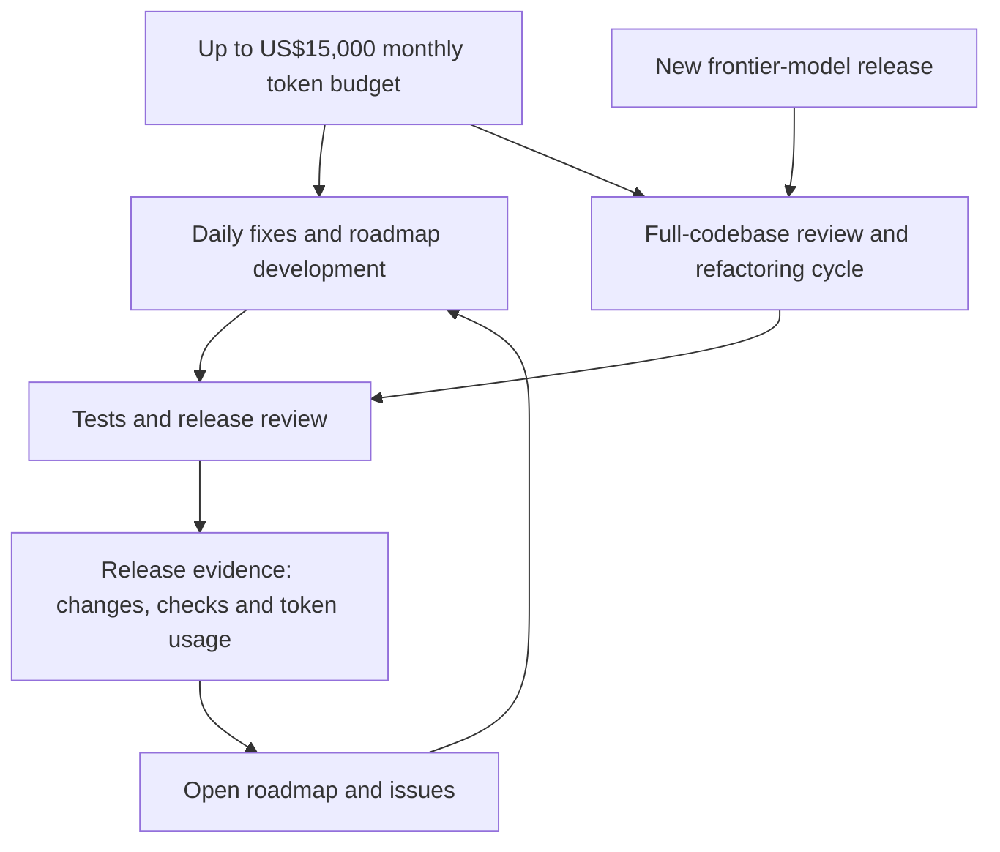

# weave

## Platform

web

## Product purpose

weave is a portable work system you own, developed in the open. Connected
records, documents and automations share one model. People use the browser;
their existing agents use MCP, REST and CLI over the same engine.

## Users

weave serves individuals and small teams who organize related work and already
use an agent. People inspect and edit the same records their agents operate.
Operators can run the application locally, on their own server, or use weave
cloud. A local install needs no account and sends no telemetry.

## Product principles

### 1. Integrated listening

External changes become work in the same system that stores it. Inbound
webhooks and API polling feed automations; rules, runs and failures remain
inspectable. Outbound retries persist across restarts. Listening is an
established automation pattern, and weave integrates it with its record model.
The first poll establishes a baseline, and disappearance from a polled list
does not emit a deletion event. See [automations](src/handbook/guides/automations.md).

### 2. Retrieval that fits the work

Current search matches text across names, fields, documents and comments.
Optional semantic retrieval is a product direction, not a shipped capability.
It should complement exact search, preserve access boundaries and return source
records. A model provider should remain a deliberate choice.

### 3. Your existing agent

You already have an agent. weave works natively with it. Your tools should
support that agent without making you manage another assistant inside every
productivity app. Native MCP, REST and CLI access covers records, documents,
schema and automation. Connection setup and permissions remain explicit;
connecting a tool does not automatically unify an agent's memory or context.
See [agent access](AGENTS.md#using-weave).

### 4. Understandable access

Observer, editor and architect roles establish workspace access. Private
spaces, member roles and space-scoped tokens let a team narrow it. Share links
grant a defined scope; credential grants protect secret values separately.
A key field stores a reference to a credential, not the secret itself. Hiding a
column does not conceal its value, and ordinary fields have no general
field-level read permissions. See [access rules](src/access.js) and
[key fields](src/handbook/fields/key.md).

### 5. Documents with a structured home

A document belongs to a record with typed properties and relations. Its prose
can remain free-form while its home supplies context. Document URLs expose
Markdown, HTML and PDF representations to browsers, scripts and agents.
ID-based permalinks survive renames; changing the host still needs routing or
redirects. HTML-document scripts execute on the application origin, so their
authors must be trusted. See [documents](src/handbook/fields/document.md).

### 6. Structure as records

Spaces, tables and fields have system records that people and agents can
inspect and operate. Multi-target relations can connect an issue to a project,
a table or a space through one field. This combines schema records with
polymorphism; neither idea alone supplies the whole behavior.

Ordinary relations provide paired inverse fields. Multi-target relations have
no inverse field, and lookups and rollups do not support them. A relationship
with its own properties, such as an assignment with hours and a role, still
belongs in a junction record. See [polymorphic relations](src/handbook/guides/polymorphic-relations.md).

### 7. Developed in the open

Open source. Open tests. Open roadmap. Inspect implementation and test code in
the repository, results in [GitHub Actions](https://github.com/grunion-ai/weave/actions),
and planned work in the [development workspace](https://weave.grunion.ai/w/weave).
Every weave cloud account can read its roadmap, issues and generated Quality
mirror. Public tests expose what is checked; a passing run identifies which
checks passed on a particular build. Customer data, credentials and private
vulnerability reports remain private.

## Technical fit

| Property | Practical consequence | Boundary |
| --- | --- | --- |
| One Node process and SQLite workspace storage | Run locally or on a small server without a separate database service | Attachments and keystore material need appropriate backup handling |
| Zero runtime dependencies and no build step | Run from a checkout | Third-party assets are vendored and pinned; self-hosting still needs maintenance |
| SQLite, JSON interchange and backup/restore | Move and independently operate the workspace | An export and a complete operational backup are different artifacts |
| Stable form IDs, input keys and aliases | Capture through browser, HTTP, CLI and MCP without general write access | Hidden fields are server-filled; anonymous intake is operator-enabled |
| Persisted form retry receipts | Retry the same intended submission after a timeout or restart | The documented receipt window is 24 hours; rate and capacity limits apply |
| MIT source and HTML documents | Modify the runtime or create web-native content | Trusted HTML is not a sandbox for untrusted authors |
| Local execution | Local operations need no cloud round trip | No comparative speed or scale claim follows from architecture alone |

The [forms guide](src/handbook/guides/forms.md) defines the ingestion contract.
The [backup guide](src/handbook/guides/backup-and-restore.md) defines recovery.

## Continuous improvement

The project allocates up to **US$15,000 in monthly token budget for continuous
improvement**. This is the owner's maintenance commitment, not a statement of
actual spending or a minimum expenditure. The commitment covers multiple daily
fixes and roadmap developments, token usage reporting for each release, and a
full-codebase review and refactoring cycle with every new frontier-model release.

The diagram describes the maintenance commitment and intended evidence flow.
Release-level token accounting and a complete feature-to-test-result evidence
chain remain planned work; the diagram does not report measured delivery or
spending.

Each release report should identify its version, commit, linked work, model
versions, measured input/output and cached tokens, accounting coverage, and
verification results. Unknown usage stays unknown. Estimated API-equivalent
value, subscription allowance and actual billed cost must remain distinct.
Shared research and failed attempts need explicit allocation rather than silent
omission. Refactoring cycles should name their triggering model, scope and
findings; verified improvements can ship incrementally without rewriting
working code merely because a model changed.

## Service and brand contracts

Production runs at https://weave.grunion.ai. Promotion follows successful CI
and dev soak checks; [DEVELOPMENT.md](DEVELOPMENT.md) owns the deployment process.
The public status page helps users check production web, API and MCP
availability and follow incident updates. Monitoring runs independently of the
application and records observed history. Missing measurements are unknown.
Operators publish incidents; visitors do not submit reports through the status
page. Historical uptime before monitoring began is unavailable and must not
be fabricated.

Preserve the weave name, rope mark, and light and dark surface palettes in
[brand/README.md](brand/README.md). Product claims distinguish current behavior,
proposed capabilities, maintenance commitments and measured results.
