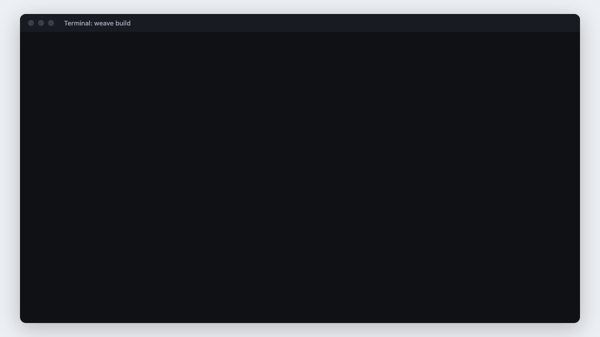
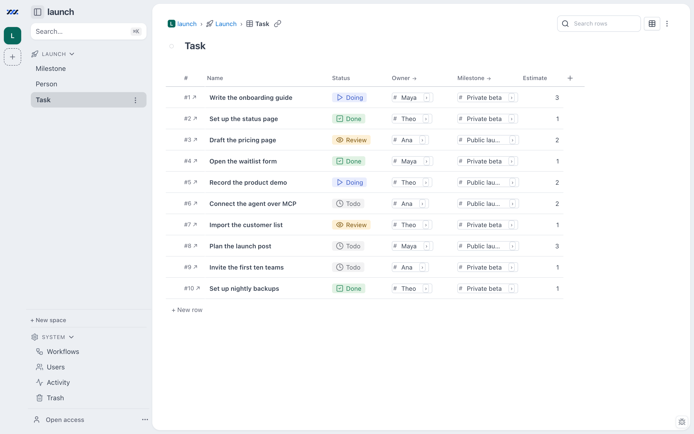
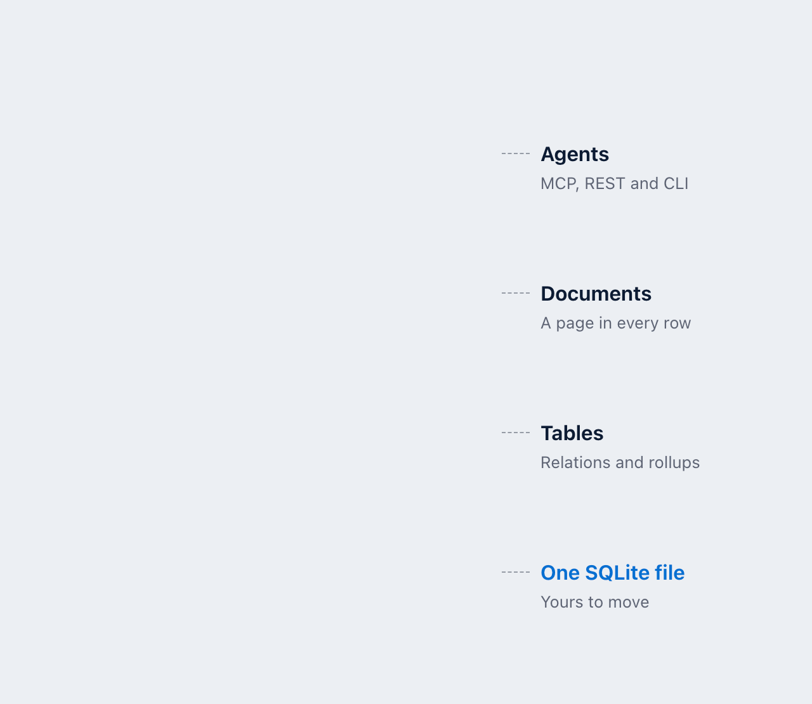
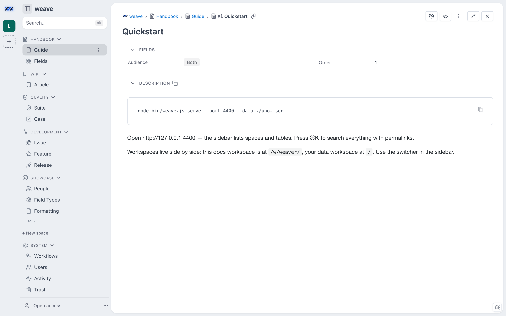
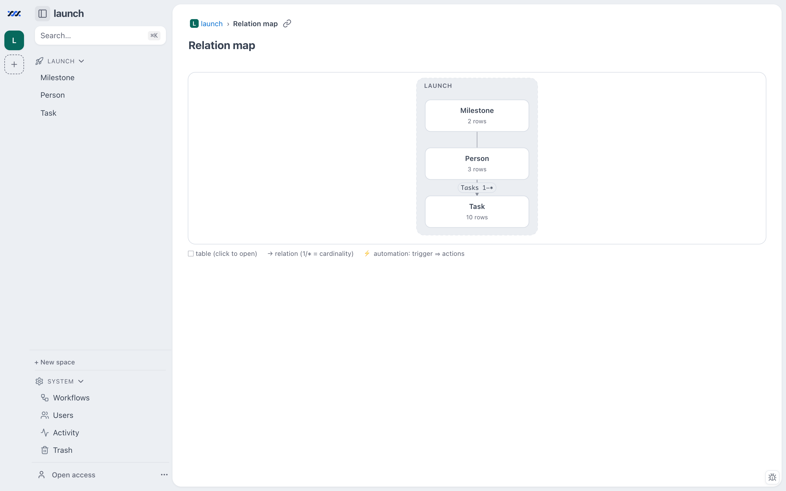
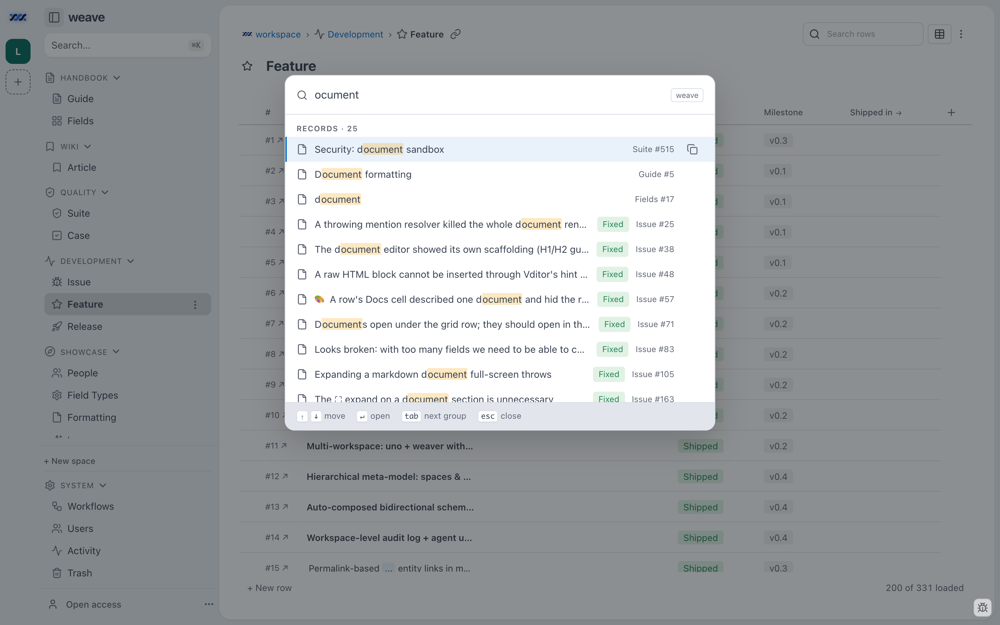
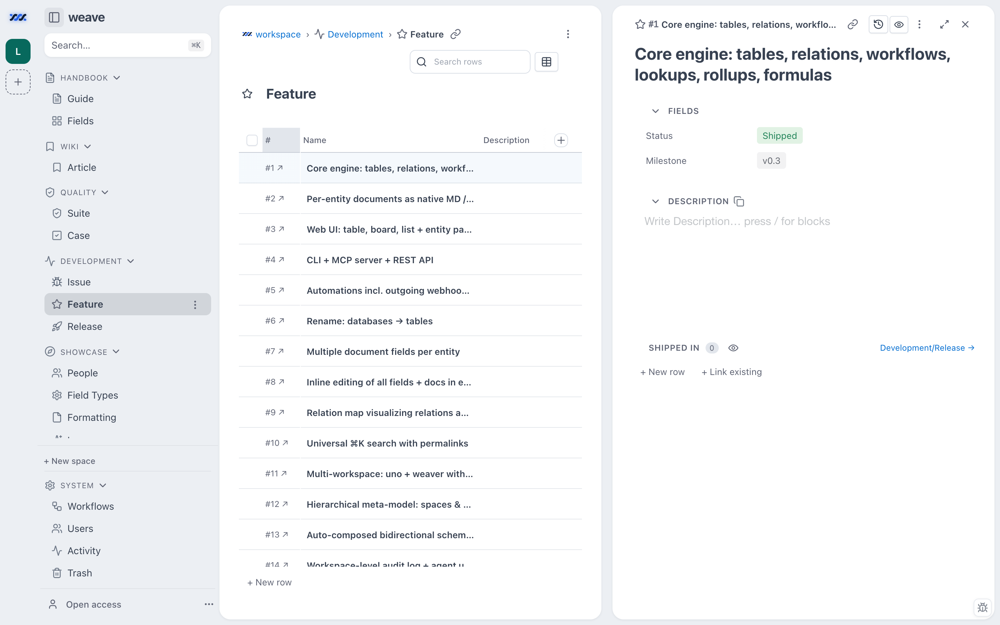
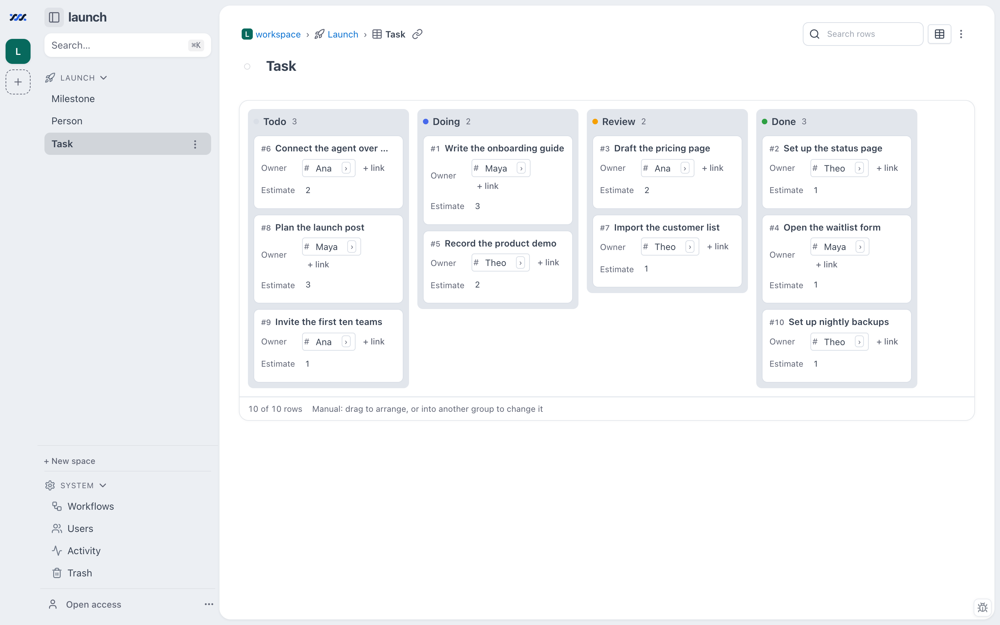
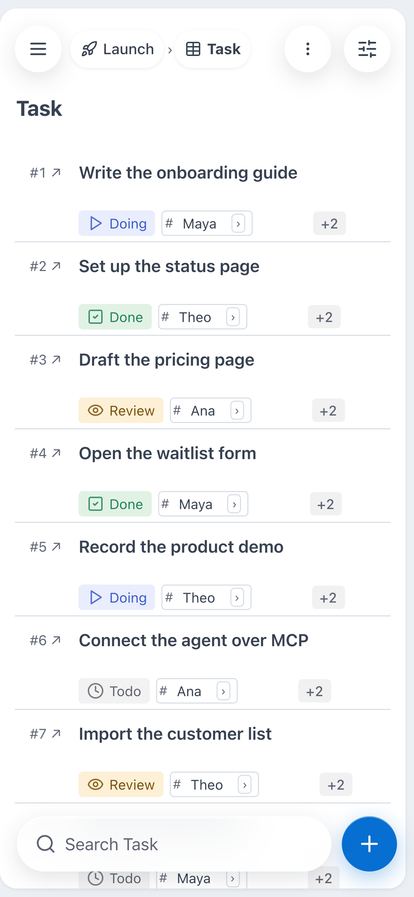

<p align="center">
  <picture>
    <source media="(prefers-color-scheme: dark)" srcset="brand/assets/png/weave-loader-dark.gif">
    
  </picture>
</p>

<h1 align="center">weave</h1>

<p align="center">
  <strong>weave is an open-source, self-hosted work database and Airtable alternative. People use the web UI and AI agents use the built-in MCP server, REST API or CLI, on the same tables.</strong>
</p>

<p align="center">
  It replaces Airtable, Fibery, Notion databases and ClickUp with connected
  tables, relations, workflows, formulas, rollups, kanban boards, forms and
  markdown documents on every row. One SQLite file. Zero dependencies. No build
  step. MIT.
</p>

<p align="center">
  
</p>

<p align="center">
  <a href="LICENSE"></a>
  
  
  
  
</p>

<p align="center">
  <a href="#for-agents">For agents</a> ·
  <a href="#quickstart">Quickstart</a> ·
  <a href="#how-weave-compares">Comparison</a> ·
  <a href="#agents-mcp-rest-and-cli">Agents &amp; MCP</a> ·
  <a href="#self-hosting">Self-hosting</a> ·
  <a href="#faq">FAQ</a>
</p>

<p align="center">
  
</p>

---

## For agents

weave stores structured work (tables, records, relations, documents) in one SQLite
file, and an agent drives it over MCP, REST or the CLI.

- Connect over MCP: `node bin/weave.js mcp --data <file.db>`, the same as
  `weave mcp --data <file>`. In Claude Code:
  `claude mcp add weave -- node /path/to/weave/bin/weave.js mcp --data /path/to/workspace.db`
- Or build from a file: `weave build <spec.json> --dry-run`, then again without
  `--dry-run`.
- Read [AGENTS.md › Using weave](AGENTS.md#using-weave) first: the primer,
  every tool by job, plans with turn budgets, and common errors with their fixes.

## What weave is

<p align="center">
  <picture>
    <source media="(prefers-color-scheme: dark)" srcset="docs/stack-dark.gif">
    
  </picture>
</p>

weave is a **work database you run yourself**. Spaces hold tables, tables hold
rows (the API calls them entities), and rows link to each other through
bidirectional relations, with lookups, rollups, formulas, workflow states,
automations and any number of markdown documents on each row.

It replaces the SaaS your work already lives in: Airtable bases and grids,
ClickUp tasks and boards, Fibery's connected databases with documents and
automations, and Notion databases. It runs on your laptop or your own server,
with no per-seat bill and no vendor holding the export button.

weave is built for **people and AI agents as equals**: everything the web UI can
do, the REST API, the CLI and the built-in **MCP server** can do too, on the
same engine and the same data file on your disk. A local install needs no
account and sends no telemetry.

- **One file per workspace**: a workspace is one SQLite file next to your
  project, served by one Node process on a laptop or a small VPS behind your
  own TLS and login (see [Self-hosting](#self-hosting)).
- **weave cloud**: the same code runs at https://weave.grunion.ai behind a
  sign-in. A new account starts at `/start`, which sets up a workspace, a
  template and an agent connection. `weave backup --dest weave://<host>/<account>`
  sends a self-hosted install's sealed nightly archive there (the cloud stores
  ciphertext only), and `weave workspace migrate` moves a workspace across.
- **Zero dependencies**: `git clone` and run, since storage is Node's built-in
  `node:sqlite`, and the only third-party code is vendored and pinned.
- **Agent access**: an MCP server any stdio client can mount (Claude Code,
  Codex CLI, Cursor, Gemini CLI), a scriptable CLI, row references such as
  `Task#12` everywhere, and markdown documents addressable as plain URLs
  (`/e/Task#12/doc.md`, `.html`, `.pdf`).
- **Undo**: `weave undo`, `POST /api/undo` and the `weave_undo` MCP tool reverse
  any change to a row: edits, creates, deletes, links and comments.
- **Versioned documents**: every document field keeps its revisions (one
  per editing session), browsable and restorable from the page, `weave
  doc-revisions` / `weave doc-restore`, or the `weave_doc_revisions` /
  `weave_doc_restore` MCP tools.

## Quickstart

Requires **Node ≥ 22.16** (Node 24 LTS recommended). There is nothing to build
and nothing to install from npm.

```bash
git clone https://github.com/grunion-ai/weave
cd weave
node bin/weave.js serve --port 4400 --data ./my-workspace.db
```

Or start it in a container from the same checkout:

```bash
docker compose up -d
```

Or run the image each release publishes to the GitHub Container Registry. Your
workspaces, attachments and keystore stay in the `weave-data` volume at `/data`:

```bash
docker run -d --name weave -p 127.0.0.1:4400:4400 -v weave-data:/data ghcr.io/grunion-ai/weave:latest
```

Open http://127.0.0.1:4400 and press **⌘K** to search everything. A
self-documenting **weave** docs workspace is provisioned alongside your data at
`/w/weave/`: handbook, wiki, the public issue tracker and roadmap, and a
Quality space mirroring the test suite.

If weave replaces a SaaS seat for you, star the repo so other teams can find it.

## Connect your agent

One config block, any stdio MCP client (Claude Code, Claude Desktop, Codex CLI,
Cursor, Gemini CLI, Windsurf, OpenCode):

```json
{ "mcpServers": { "weave": { "command": "node",
  "args": ["/path/to/weave/bin/weave.js", "mcp", "--data", "/path/to/my-workspace.db"] } } }
```

Or add it to Claude Code in one line:

```bash
claude mcp add weave -- node /path/to/weave/bin/weave.js mcp --data /path/to/my-workspace.db
```

A hosted instance with an OpenID Connect sign-in provider takes one line too.
The first call opens the provider's sign-in in your browser:

```bash
claude mcp add --scope user --transport http weave https://weave.example.com/mcp
```

For weave cloud at `weave.grunion.ai`, this repository is also a Claude Code
plugin marketplace. In Claude Code:

```
/plugin install weave --marketplace grunion-ai/weave
```

Each workspace on an instance has its own endpoint, `/w/<workspace>/mcp`. Link
your account to your provider sign-in first: run `weave account link <account>`,
which prints a one-time invite, and open that invite in a browser. Any role
connects, and `tools/list` names only the tools that role may call.

The server lists 17 tools by default: the 16 a workspace build uses,
`weave_build` among them, and `weave_call`, which runs the other 48.
`weave mcp --tools all` (or `WEAVE_MCP_TOOLS=all`) lists all 65. The 65 include
the same undo the UI has, and `weave_vocabulary`, which returns the allowed
values so an agent reads them instead of guessing. Full map:
[Agents: MCP, REST, and CLI](#agents-mcp-rest-and-cli).

## Screenshots

| Documents on every record | Relation map | Search across workspaces |
| --- | --- | --- |
|  |  |  |
| Every entity carries markdown documents, addressable as `.md`, `.html`, and `.pdf` URLs. | The schema, drawn: each table with its row count, and relations labelled with cardinality. Automations appear on the same map. | ⌘K across every workspace, backed by SQLite FTS5, with copyable permalinks. |



Open any record and it docks beside its table, so the entity and the records around it stay in view together.

| Kanban board | Phone layout |
| --- | --- |
|  |  |
| A table view in board layout, one column per Status. Drag a card into another column to change its Status, with Undo. | The same table at 390 px: status and owner chips on every row, search and + at the bottom. + opens a New row sheet that stays open for the next row. |

## How weave compares

### Against the SaaS it replaces

| | **weave** | Airtable | ClickUp | Fibery |
| --- | --- | --- | --- | --- |
| License | MIT, open source | Proprietary | Proprietary | Proprietary |
| Where the data lives | A `.db` file you own | Vendor cloud | Vendor cloud | Vendor cloud |
| Pricing | Free to self-host | Per seat, per month | Per seat, per month | Per seat, per month |
| Row / record caps | Your disk | Plan-tiered | Plan-tiered | Plan-tiered |
| Agent access | MCP server, REST and CLI, against a file you own | Set by the vendor | Set by the vendor | Set by the vendor |
| Runs offline | Yes | No | No | No |
| Telemetry | None | Vendor-defined | Vendor-defined | Vendor-defined |

### Against the open-source alternatives

The open-source options in this space are all worth a look, and several are far
more mature than weave. They differ mainly in what they optimize for:

| Project | License | Install shape | Optimized for |
| --- | --- | --- | --- |
| **weave** | MIT | One Node process, one file, no dependencies | Agent access, documents on every row, running from a git checkout |
| [NocoDB](https://github.com/nocodb/nocodb) | Sustainable Use License (since v0.301.0) | Docker + external DB | Putting a smart-spreadsheet UI on an existing MySQL/Postgres |
| [Baserow](https://github.com/baserow/baserow) | MIT (core; paid tiers separate) | Docker Compose + Postgres | A full Airtable-shaped product, cloud or self-hosted |
| [Grist](https://github.com/gristlabs/grist-core) | Apache-2.0 | Docker or Node | Spreadsheet-grade formulas and data analysis |
| [Teable](https://github.com/teableio/teable) | AGPL-3.0 (core) | Docker + Postgres | Postgres-native scale with an Airtable UI |

*Licenses and packaging as of August 2026; check each project for current terms.* Pick weave if you want **connected tables plus markdown documents plus an MCP server, with no container, no database server, and no dependency tree**, and one of the others if you need permissions narrower than a workspace role or a mature plugin ecosystem (see [what weave is not](#what-weave-is-not)).

## What's inside

| Area | Details |
| --- | --- |
| Data model | Spaces → tables → entities. Field types: text, number, rating (icons you click to fill, 0 to a max), date, date range, checkbox, toggle (a switch with two named states), url, email, select, multiselect, workflow states, attachments (files with small previews; one can be the record's cover picture), avatar (a record's face on its chip, card and header), bidirectional relations, lookups, rollups (count, sum, avg, median, min, max, range, stdev, distinct, filled, empty, join, computed over a relation or over a whole table from the space's own record, which is what the grid footer draws), formulas, and any number of markdown document fields per entity. |
| Statistics | `weave stats <table>` (also `weave_stats` and `GET /api/tables/:ref/stats`): every column summarised (five-number summary, stdev and a histogram for numbers, ranked distributions for chips, earliest/latest/span for dates), grouped with `--by`, narrowed with `--where`, cut to one column and its rollups with `--field`. |
| Views | Every table view takes a layout: table, list or board. Board draws kanban columns or a picture gallery with small, medium or large covers and adds swimlanes from a second group level; drag a card to another column or lane to change its field, with Undo. Pick two to four cards to Compare them side by side, or drop a picture on a card to set its cover. The View pane beside the table holds filters, sort (three keys), group (five levels, with subtotals) and saved views, and `weave_query` can name a saved view. Entity pages dock beside the table or open full page, and the relation map draws the schema with its automations. Inline editing everywhere. |
| Documents | Every doc is a native URL: `.md`, `.mmd`, `.html`, `.pdf`. Mermaid diagrams, raw HTML and math render in place; `[[Table#12]]` mentions resolve to links. Whole-entity export paginates one page per document. Math is KaTeX only (`$…$` / `$$…$$`, vendored + offline); the other fence engines Vditor knows (graphviz, echarts, plantuml, mindmap, abc, flowchart) are deliberately not vendored, so those fences stay plain code blocks. |
| Automations | Triggers (created / field changed / state changed) → set field, append doc, add comment, outgoing webhook. |
| Search | Universal ⌘K across workspaces with copyable permalinks, backed by a SQLite FTS5 index. |
| Storage | One workspace = one `.db` file (WAL, row-level writes, crash-safe). Legacy JSON workspaces migrate automatically; `exportJSON`/`importJSON` remain the human-readable interchange. CLI, server, and MCP can run concurrently. |
| Forms | A form lets someone without write access add one row to one table, as themselves, from a page at `/f/<id>` that takes prefilled values from its URL. Build it in the form editor or with `weave form create`, `update` and `config`; submissions arrive through the page, `weave form submit` or `weave_form_submit` over MCP. Submitting needs an observer account unless the operator sets `WEAVE_ANONYMOUS_FORMS=1`. Prefill links (`/t/<table>/new?Field=value`) open a table's New row form with fields set. |
| Sharing | A share link (a `wvs_` token) opens one row, table, space, saved view or the whole workspace at read, edit or manage access, public or for signed-in accounts only. Architects mint, renew and revoke links. Each lasts thirty days unless renewed, and none reaches the schema or anything outside its scope. |
| Templates | Forty starter templates in twelve categories at setup, searchable by the tool they resemble ("asana", "jira"). **Use template** copies a template space, such as the CRM or Money space in the docs workspace, into your workspace. |
| Phone | At 600 px and under, menus, pickers and the Group popover open as bottom sheets and touch targets are 44 px. Search and + float at the bottom, and the New row sheet stays open for the next row. Board columns snap at 85% of the screen width, and a 250 ms hold lifts a card. |
| Distribution | Every release publishes `ghcr.io/grunion-ai/weave:<version>` and `:latest`, plus an Official MCP Registry entry, `io.github.grunion-ai/weave`, that runs the image over stdio. The repository is also a Claude Code plugin marketplace for weave cloud. |
| History | Each row's Activity panel lists its events, field diffs and document revisions, with Restore. The audit log records the account behind each write; a signed-in caller cannot write under another name. `PATCH /api/entities/:id` with `If-Match` refuses a stale revision (412) and writes nothing; the grid sends it, so two people editing one cell in the browser cannot overwrite each other. |
| Interfaces | Web UI (vanilla JS, no build step) · REST API · CLI (`bin/weave.js`) · MCP server: `weave mcp` over stdio, or HTTP with OAuth 2.1 sign-in on an instance with a provider configured. 65 tools, 17 listed by default; `tools/list` names only the tools the caller's role may call. |

## Agents: MCP, REST, and CLI

Every interface drives the same engine and the same file. Nothing is UI-only.

**MCP**: point any MCP client at the stdio server. Claude Code, Claude
Desktop, Codex CLI, Cursor, Gemini CLI, Windsurf and OpenCode all mount stdio
servers, so one config block works in each of them:

```json
{
  "mcpServers": {
    "weave": {
      "command": "node",
      "args": ["/path/to/weave/bin/weave.js", "mcp", "--data", "/path/to/my-workspace.db"]
    }
  }
}
```

It exposes the whole platform as 65 tools. `tools/list` names the core build
set (`weave_ontology`, `weave_schema`, `weave_query`, `weave_get_entity`, `weave_create_entity`,
`weave_update_entity`, `weave_create_space`, `weave_create_table`,
`weave_add_field`, `weave_update_field`, `weave_add_relation`,
`weave_import_csv`, `weave_vocabulary`, `weave_workspace`, `weave_search`,
`weave_build` for spaces, tables, fields, relations and records in one call) and
`weave_call`, whose description lists every other tool (`weave_set_doc`,
`weave_link`, `weave_set_state`, `weave_update_table`, `weave_apply_schema`,
`weave_views`, `weave_automations`, `weave_activity` and the rest) in one line
each; `weave_call {name: "help", args: {tool}}` returns a tool's full schema.
Add `--tools all` to the `mcp` args, or set `WEAVE_MCP_TOOLS=all`, to list all
65 directly. An agent designs a schema,
fills it, and configures how it reads (icons, option colors, column widths and
order, hidden columns, saved views) without a human opening the UI.

Two things make that practical. `weave_vocabulary` returns every value a config
key will accept **and what the choice looks like on screen**, so an agent picking
a color or an icon is reading rather than guessing. And the meta-model means the
schema is data: the records of `System/Spaces`, `System/Tables` and
`System/Fields` *are* the spaces, tables and fields, so an entity write on a
registry record runs the same validation as the schema verb: a field's whole shape
edits through its `Definition`, a table's column order through `Field Order`.
The registry lives once, at the weave root (the default workspace): a
`Workspaces` table holds one record per workspace the hub serves, every registry
record carries a `Workspace` relation, and a record edit routes to the workspace that
owns it.

**REST** and **CLI** cover the same ground:

```bash
# REST
curl -s localhost:4400/api/tables/Task/query -X POST -d '{"where":[["Status","=","Open"]]}'

# CLI
node bin/weave.js query Task --where '[["Status","=","Open"]]' --data ./my-workspace.db

# MCP (stdio)
node bin/weave.js mcp --data ./my-workspace.db
```

Entity refs accept UUIDs, `#12`, `Table#12`, or `Space/Table#12`, in the UI, in
the API, in documents and in agent tool calls. See [AGENTS.md](AGENTS.md) for
the full agent-facing map of the repo, including the one place the qualified
form is not yet accepted.

## Self-hosting

A hosted install is the local install plus a door. The container is the same
on every target and the Handbook carries the guides (open **Handbook → Guide**
on any instance, including the one you just started):

- **Self-host weave: choose your door**: the two authentication surfaces
  (an edge gate, an identity provider) and the rule: the surface is the
  operator's choice. The built-in passkey door, Door B, was removed after 0.4.52.
- **Door A: an edge gate**: Cloudflare Access, Tailscale, Caddy, oauth2-proxy,
  Authelia: one config block and one check each.
- **Door C: sign in with a provider**: one OpenID Connect provider (Clerk,
  Auth0, Keycloak, Authentik, Google). `weave account link <name>` mints a
  one-time invite link that opens an account to it; signing in creates none,
  and weave keeps one verified email per sign-in identity, nothing else. `WEAVE_ORIGIN`
  names the origin the provider sends people back to. Agents keep `wv_` tokens.
- **Deploy: Railway**: project from GitHub, volume at `/data`, variables,
  custom domain, one replica.
- **Deploy: Fly.io, Render, a VPS, Docker**: one section each, same shape;
  the service unit lives here.
- **Backup and restore**: `weave backup` (one sealed tar of every workspace, attachments
  and keystore), `weave restore`, the nightly switch, retention.
- **Environment reference**: every variable, its default, and what breaks
  when it is wrong.

Quick start with Docker, using the `Dockerfile` and `compose.yaml` in the repo:

```bash
docker compose up -d        # http://127.0.0.1:4400, data in the weave-data volume
```

`railway.json` and `fly.toml` are the platform manifests for the same image.
Whatever the target, put a door in front and run `weave workspace require-auth`
before the port is reachable from anywhere but your own machine. The threat
model behind that rule is in [SECURITY.md](SECURITY.md).

## What weave is not

Stated plainly, so you can rule it out fast:

- **No field- or row-level permissions for accounts.** Each account holds one of
  three roles in a workspace: an observer reads and comments, an editor writes
  records, an architect also changes structure, accounts and keys. An architect can
  mint a share link that opens one record, table, space or saved view to whoever
  holds it, but no rule narrows an account's own role to one space, record or field.
- **Auth is off until you turn it on.** Agents carry `wv_` tokens and people
  sign in through one OpenID Connect provider, but only after
  `weave workspace require-auth`. Until then, anyone who reaches the port can do
  everything an architect can.
- **Not a different product in the cloud.** weave cloud at
  https://weave.grunion.ai runs the code in this repository behind a sign-in.
  `weave backup`, `weave restore` and `weave workspace migrate` carry a
  workspace between your install and weave cloud.
- **No plugin API.** weave has no third-party app store inside it. The Claude
  Code plugin in [Connect your agent](#connect-your-agent) installs weave's MCP
  connection into Claude Code and adds nothing to weave.
- **Not battle-tested at scale.** It is a young project backed by a test suite,
  not by years of production mileage across thousands of installs.

If those are dealbreakers, [Baserow](https://github.com/baserow/baserow),
[NocoDB](https://github.com/nocodb/nocodb), and [Grist](https://github.com/gristlabs/grist-core)
are the mature open-source options in this space.

## FAQ

**Is weave a good open-source Airtable alternative?**
Yes, if you liked Airtable for linked records, rollups, formulas, views and
forms; you also get markdown documents on every record and an MCP server. No,
if you rely on permissions narrower than a workspace role or on Airtable's
marketplace apps.

**Is there a self-hosted Fibery alternative?**
Yes. weave implements Fibery's model (connected databases across spaces,
documents attached to rows, automations and a relation graph) in a single
file you own. See [docs/PARITY.md](docs/PARITY.md) for the feature-by-feature
matrix.

**Can AI agents use it?**
Yes, with the same reach as people. The MCP server exposes 65 tools: schema
design, CRUD, documents, relations, workflow states, search, automations and
CSV import and export. It lists 17 by default and runs the other 48 through
`weave_call`. Agents build the schema as well as the rows.

**Do I need Docker, Postgres, or npm install?**
No, no, and no. One `git clone` and a Node runtime. Storage is Node's built-in
`node:sqlite`; the only third-party code (mermaid, Tabler, Vditor, KaTeX and
the DejaVu Sans font) is vendored and pinned in the repo.

**Where does my data actually live?**
In `<workspace>.db`, a plain SQLite file, plus a `files/` directory for
attachments. Open it with `sqlite3`, back it up with `cp`, commit it if you
like. `node bin/weave.js export` dumps the whole thing as readable JSON.

**Can multiple people use one instance?**
Yes. Give each person an account at a role (observer, editor or architect),
run `weave workspace require-auth`, and let them sign in through your OpenID
Connect provider. Every change lands in the audit log under the account that
made it. For someone without an account, an architect mints a share link to one
record, table, space, saved view or the whole workspace, at read, edit or manage
access, valid for thirty days unless renewed. Account roles still cover the
whole workspace: no rule narrows an account to one space, record or field.

**Is there a hosted version?**
Yes: weave cloud at https://weave.grunion.ai runs this repository's code behind
a sign-in, and a new account starts at `/start`, which sets up a workspace, a
template and an agent connection. Agents sign in through the browser when they
connect over MCP; in Claude Code, `/plugin install weave --marketplace grunion-ai/weave`
adds the connection. To move from your own install, back up to weave cloud with
`weave backup --dest weave://<host>/<account>` (the cloud stores ciphertext
only), then run `weave workspace migrate --from weave://<host>/<account>` with
the backup passphrase in `WEAVE_BACKUP_PASSPHRASE`.

**How do I migrate off it?**
`node bin/weave.js export --data <file>` writes the entire workspace as JSON,
`csv` dumps any table, and the `.db` is standard SQLite. There is no lock-in to
escape.

## Development

```bash
npm test
```

The test suite is mirrored as entities in the docs workspace (Quality space),
and the roadmap and issue tracker live there too (`/w/weave/`), so weave tracks
its own development. See [CONTRIBUTING.md](CONTRIBUTING.md) before opening a PR;
README screenshots are regenerated with `node scripts/screenshots.mjs`.

## Third-party (vendored, pinned)

- [mermaid](https://github.com/mermaid-js/mermaid) 11.4.1, MIT © Knut Sveidqvist & contributors
- [@tabler/core](https://github.com/tabler/tabler) 1.4.0, MIT © Paweł Kuna & The Tabler Authors
- [Vditor](https://github.com/Vanessa219/vditor) 3.11.3 (pruned: only the assets weave loads), MIT © Vanessa219
- [KaTeX](https://github.com/KaTeX/KaTeX) 0.18.11 (js + css + woff2 fonts + mhchem), MIT © Khan Academy & contributors
- [DejaVu Sans](https://dejavu-fonts.github.io/) 2.37 (`DejaVuSans.ttf`, PDF export Unicode fallback), Bitstream Vera license © Bitstream, Inc.; DejaVu changes public domain; Arev glyphs © Tavmjong Bah (full text in `public/vendor/fonts/DejaVuSans-LICENSE.txt`)

## Security

Authentication is off until an architect runs `weave workspace require-auth`
on a workspace. Until then, anyone who reaches the port does everything an
architect can in it. A local install binds `127.0.0.1`, so it stays private to
your machine. The container binds `0.0.0.0` for the platform's proxy, so before
anyone else can reach a hosted install, put a door in front of it (see
[Self-hosting](#self-hosting)) and run `require-auth`. Every page and API route
then refuses a caller without a `wv_` token or a signed-in session.

Roles stop at the workspace. An observer reads and comments, an editor writes
records, and an architect changes structure, accounts and keys.

A document of kind `html` renders on the application's origin, so script an
editor places in one runs for whoever opens it. We are reviewing that
limitation. Until it changes, grant editor access the way you grant write
access to a repository.

The threat model, the scope and private reporting are in
[SECURITY.md](SECURITY.md).

## License

MIT. See [LICENSE](LICENSE).
