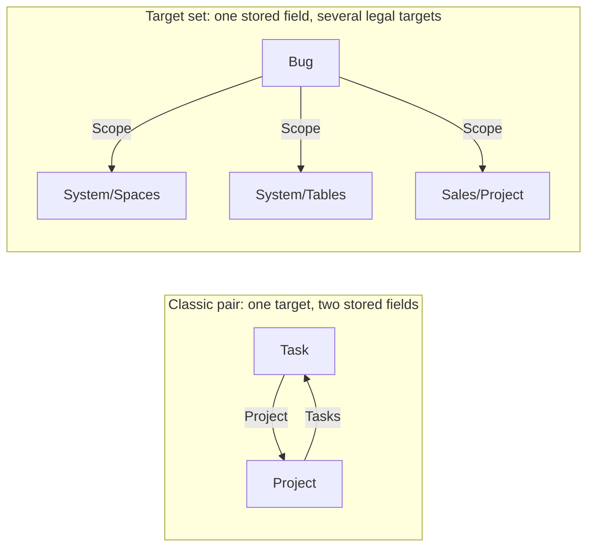
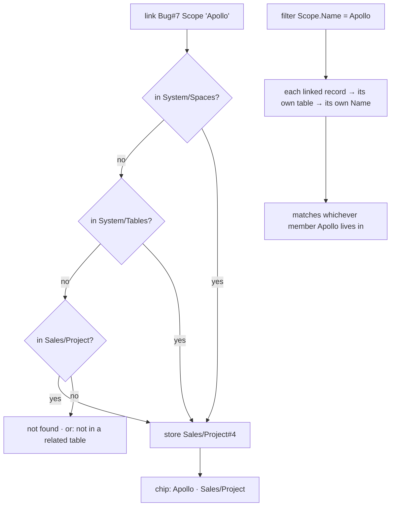
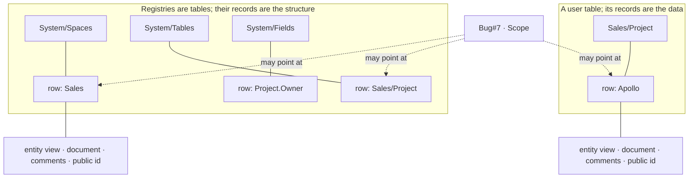
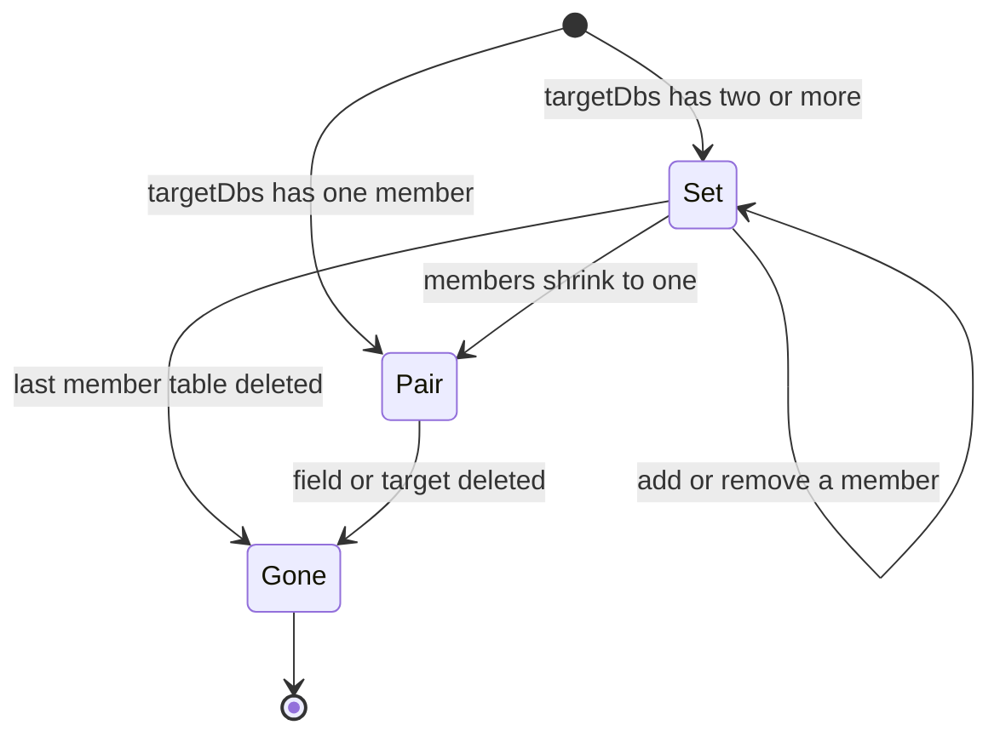

# Polymorphic relations

A relation field normally points at one table. In weave it can point at several, a **target set**, and two of the legal members are the workspace's own registries: `System/Spaces` and `System/Tables`. A bug can be scoped to a whole space. A dependency can name an entire workstream. An agenda can mix records with the structure that holds them. This page is what a target set is, how the engine carries it, and why it was built this way rather than the way every other tool builds it.

## The classic pair

```bash
weave relation add Task Project Project --cardinality many-to-one --inverse Tasks
```



One target table makes the bidirectional pair: `Task.Project` on one side, `Project.Tasks` on the other, minted in the same write and deleted together. Each end knows the other by `inverseFieldId`. Lookups read a field through it; rollups aggregate over it. Nothing on this page changes the pair. A singleton target set collapses to it bit-for-bit, which is what makes the feature rollback-safe: revert the code and the stored fields are the fields you had.

## The target set

```bash
weave relation add Bug Scope --target-dbs 'System/Spaces,System/Tables,Sales/Project' --cardinality many-to-one
weave link Bug#7 Scope Sales
```

```json
{ "name": "Scope", "type": "relation",
  "config": { "targetDbs": ["<Spaces id>", "<Tables id>", "<Project id>"], "many": false } }
```

Two or more tables in `targetDbs` make one field whose values may point at a record of any member. The engine stores the member ids and this side's arity, and nothing else. Only this side's cardinality matters: `many-to-one` holds one chip, `many-to-many` holds a set.

Each surface handles the set on its own terms:

| Surface | Behaviour |
| --- | --- |
| Chip | carries its **home table**, so `Apollo` from `Sales/Project` and `Apollo` the space read differently in the same cell |
| Picker | searches every member table in one box |
| Filter | traverses per row: `[["Scope.Name", "=", "Apollo"]]` resolves each linked record against its own table and matches whichever member Apollo lives in |
| Relation map | draws one edge per member, so the field reads as a fan rather than a line |
| Field dialog | one select per member plus a remove control on the same line; the set shrinks to one and the field becomes a classic pair on the next save |
| Link input | a name is resolved across the members in order; a live uuid outside the set is refused as *not in a related table*, a sharper error than *not found* |

How one value gets in, and how a filter reads it back out:



## Why a space can be a target

The polymorphism is not a special case bolted onto relations. It falls out of the model.

Every level of weave is a record. A space is a record in `System/Spaces`, a table a record in `System/Tables`, a field a record in `System/Fields`; a space has an entity view, a document, comments and a public id, the same as a task does, because it is the same kind of thing. One core kind, the Entity, is the whole ontology. Workspace, Space, Table, Field and Record are levels of it rather than separate kinds, and a relation has only ever known how to point at an entity.



So a relation whose target set includes `System/Spaces` is pointing at records in a table, which is all a relation ever did. No second link type, no "reference to structure" field, no string that holds a space name and hopes it stays valid. Rename the space and the chip follows; delete the space and the link is pruned with the record. Airtable, Notion and Fibery weld a link field to one table and keep spaces and databases outside the data, so the same relation is structurally unavailable there.

## Why it is one-way

A classic pair has an inverse because there is exactly one far table to put it on. A target set has several, and an inverse would have to be sprayed across every member: a `Bugs` column appearing on `System/Spaces`, on `System/Tables`, on `Sales/Project`, each one a stored field to keep consistent, each one a surprise on a table nobody edited. ```mermaid
graph LR
  subgraph no["What an inverse would mint (refused)"]
    B1[Bug.Scope] --> X1["Spaces.Bugs"]
    B1 --> X2["Tables.Bugs"]
    B1 --> X3["Project.Bugs"]
  end
  subgraph yes["What weave stores"]
    B2[Bug.Scope] --> Q["reverse = query: Scope.Name = Sales"]
  end
```

So no inverse is minted. The reverse direction is a **query**, not a stored field: filter the source table on the relation, `[["Scope.Name", "=", "Sales"]]`, and you have every bug scoped to that space, answered from the stored forward links and never able to drift from them.

This is the ruling from the 2026-08-28 design review, and it is the reason the schema stays quiet. A target set adds one field to one table and leaves every member untouched.

## What stays single-target

Lookups and rollups refuse a target set. A lookup reads a named field from the far side, and across three member tables there is no one far side: `Owner` may exist on one member, be a number on another, and be missing on the third. Rather than answer with the first thing that matches, the engine keeps the single-target contract and the error says why.

Filters do traverse, because a filter resolves one record at a time and each record knows its own table. That asymmetry is deliberate: a filter answers *does this record match*, a lookup promises *this column has this type*, and only the first can be kept across members.

## Lifecycle



- Adding a member is a config edit on the field. Removing one is the same edit.
- Deleting a member table prunes it from every target set that names it. The last member takes the field with it; an empty set has nothing to hold.
- Duplicate members are refused at creation. An empty list is refused.
- Chips into a deleted record disappear with the record, as they do for the pair.

## Gotchas

Name the field for the role the target plays (`Scope`, `Blocks`, `Agenda`), not for any one member. The chip already says which table it came from.

A target set that only ever holds one member is a classic pair wearing a costume. Drop the list and take the inverse.

`System/Fields` is a registry too, but it is not a useful member: a field's identity is its table's, and a relation into it reads as a pointer to a column definition. Reach for the `field` field type when a record needs to hold a field.

MCP: `weave_add_relation` takes `targetDbs` as a list; a single-element list is the pair. REST and the CLI mirror it with `--target-dbs`.

## See it in Showcase

Six tables in the **Showcase** space, one per use case, each with realistic records and a description that opens on the one-line WHY. Open a table, click any chip in the polymorphic column: the home badge names the table the record came from, and the picker searches every member.

| Case | Table | Field | Target set |
| --- | --- | --- | --- |
| Attachment target — a comment lives on anything | [[table:Showcase/Comments]] | `On` | Tasks · Docs · Meetings, one |
| Audit subject — the log points at what changed | [[table:Showcase/Activity]] | `Subject` | every Showcase table, one |
| Pointing at structure — a note about a record *or the table that holds it* | [[table:Showcase/Notes]] | `Related` | Projects · Meetings · Docs · System/Tables · System/Spaces, many |
| Sign-off target — one approval workflow for three kinds of subject | [[table:Showcase/Approvals]] | `Of` | Expenses · Contracts · Deploys, one |
| Many-to-many mixed set — one label across five tables, +N chip | [[table:Showcase/Tags]] | `Applied to` | Tasks · Docs · Projects · Meetings · Deploys, many |
| The counter-example — a plain pair because a lookup and a rollup read through it | [[table:Showcase/Line Items]] | `Expense` | Expenses only; `Expense category` is a lookup, `Line total` on Expenses a sum rollup |

The Notes case is the walkthrough in [[Article#5]]. The set was built for Feature #182.