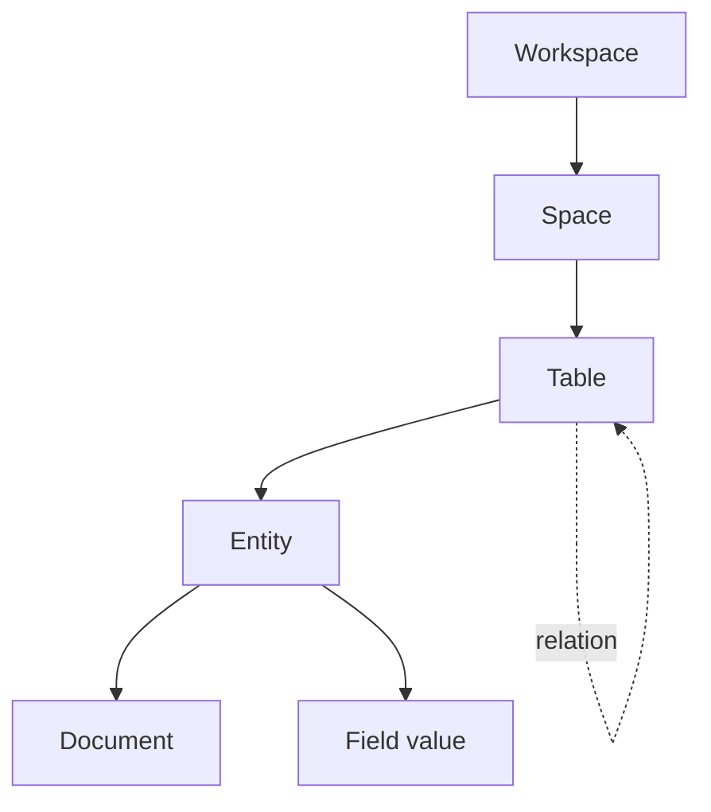
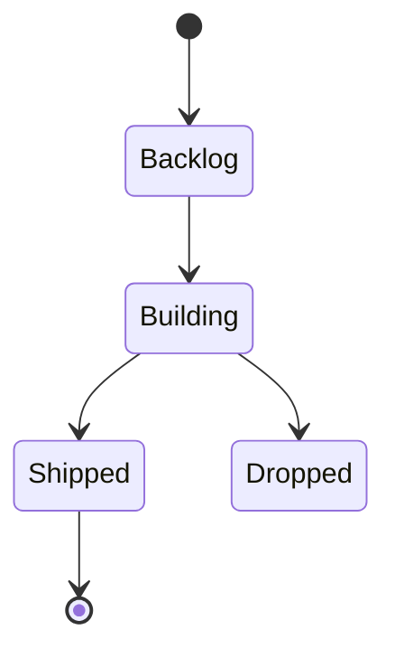

# Diagrams

A state machine:

Both render in the editor, in the rendered view, and in every export. `.mmd` is a first-class download format beside `.md`, `.html` and `.pdf`.

Graphviz, PlantUML, echarts, mindmap, abc and flowchart fences degrade to plain code blocks on purpose — six more renderers is not worth six more vendored bundles.