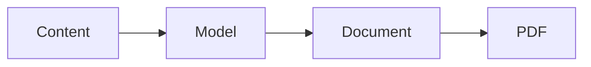

# Release note

A document does not have to pick one construct.

## What shipped

| Area | Change |
| --- | --- |
| Fields | `attachments`, `key` and `field` documented |
| Documents | this page |

## The shape

## Checklist

- [x] Pages written
- [x] Samples rendered
- [ ] Screenshot refreshed

## The maths

Coverage is $c = \frac{documented}{types}$, and this release takes it to $1$.

> Everything above is one markdown string. Export it and it comes back the same.

See [[table:Fields]] for the field reference.